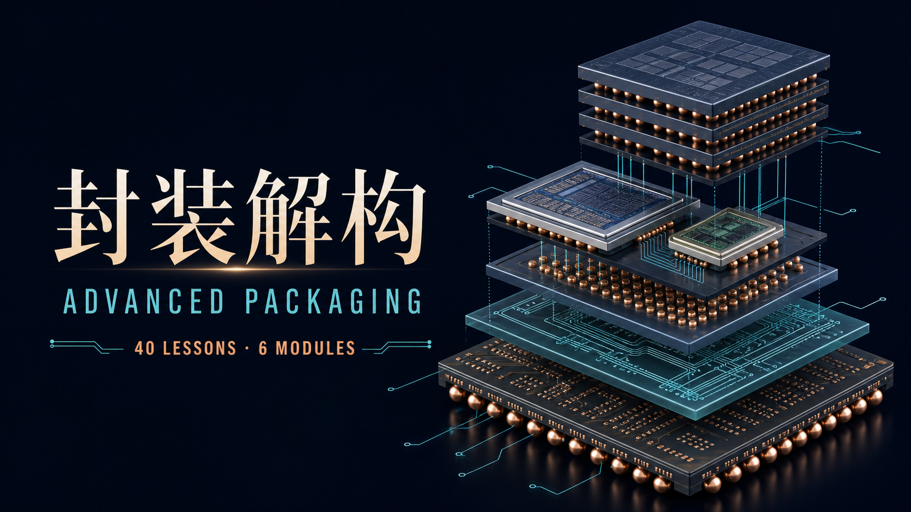

# 封装解构：半导体与先进封装完整课程

一套免费、开源、可连续阅读的中文课程。从封装物理、Chiplet、HBM 和 2.5D/3D 集成出发，逐步进入信号与供电完整性、热与可靠性、制造经济学、产业研究、论文阅读和结课项目。

[在线学习](https://fanfanfanfanfan626.github.io/advanced-semiconductor-packaging-course/) · [使用指南](https://fanfanfanfanfan626.github.io/advanced-semiconductor-packaging-course/guide.html) · [从第一课开始](https://fanfanfanfanfan626.github.io/advanced-semiconductor-packaging-course/lessons/0001-system-scaling-map.html)

[](https://github.com/fanfanfanfanfan626/advanced-semiconductor-packaging-course/releases)



## 课程内容

- 第 1–12 课：封装物理、良率、HBM、散热、供电、测试与装配
- 第 13–20 课：2.5D/3D、Fan-out、混合键合、基板、CoWoS、InFO、EMIB、Foveros、UCIe
- 第 21–26 课：信号完整性、供电完整性、热、可靠性、DFT、STCO
- 第 27–31 课：设备、材料、产能、成本与量产瓶颈
- 第 32–36 课：产业链、资料分级、财务映射、公司研究和 AI 封装案例
- 第 37–40 课：大学先修课、论文阅读、实验设计和结课项目

课程还包含 15 个速查/参考页面、可展开案例、良率与互连模拟器，以及浏览器本地保存的阅读进度。阅读不要求注册账号，也不会上传学习记录。

## 资料原则

课程引用 32 个一手来源，主要来自 IEEE Heterogeneous Integration Roadmap、TSMC 3DFabric、Intel Advanced Packaging、UCIe、SEC EDGAR、MIT OpenCourseWare，以及厂商公开技术资料。外部资料以链接和必要的事实性转述呈现，原始文档版权归各权利人。

课程中的公司、技术和财务案例仅用于教育与研究，不构成投资建议。CoWoS、InFO、EMIB、Foveros、UCIe 等名称和商标归各自权利人所有；本项目与相关机构没有隶属或背书关系。

## 本地运行

这是纯静态 HTML/CSS/JavaScript 项目，不需要安装依赖或构建。

```bash
git clone https://github.com/fanfanfanfanfan626/advanced-semiconductor-packaging-course.git
cd advanced-semiconductor-packaging-course
python -m http.server 8000
```

然后打开 `http://localhost:8000/`。也可以直接打开 `index.html`，但本地 HTTP 服务对浏览器兼容性更稳定。

## 验证

仓库自带零依赖检查脚本，用于验证 JavaScript 语法、课程数量、本地链接、重复 ID 和遗留部署地址：

```bash
node scripts/validate-site.mjs
```

GitHub Actions 会在每次提交和 Pull Request 上运行相同检查。

## 参与改进

欢迎修正事实、失效链接、术语和页面问题。涉及技术结论的修改请优先附上标准、论文、监管披露、官方路线图或厂商原始资料。详见 [CONTRIBUTING.md](CONTRIBUTING.md)。

课程可以直接在浏览器中独立学习。如果希望让 AI 按掌握式学习方法继续讲解、练习和安排复习，可配合开源项目 [Mastery Tutor](https://github.com/fanfanfanfanfan626/mastery-tutor) 使用；两者彼此独立，不安装 Tutor 也能完整阅读本课程。

## 许可证

- 网站源代码： [MIT License](LICENSE)
- 原创课程文字、图示和课程结构： [CC BY 4.0](LICENSE-CONTENT.md)
- 外部引用、商标和链接内容不包含在上述授权中，仍归原权利人所有
